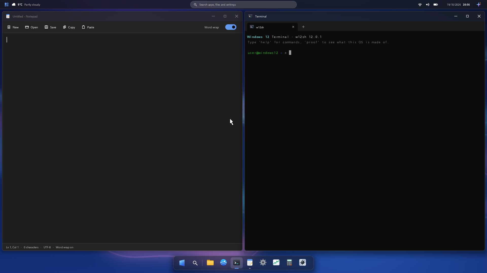

# Windows 12

<p align="center"></p>

**An unofficial fan project, not affiliated with Microsoft.** A real, bootable desktop OS for
QEMU on Apple silicon: the Linux kernel at the bottom, and **everything above `/dev/dri` and
`/dev/input` written from scratch in this repository**: PID 1, the DHCP client, the compositor,
the window manager, the widget toolkit, the shell, the terminal emulator and every app.
C, statically linked against musl. No X11, no Wayland, no Qt/GTK/SDL, no browser engine,
no busybox.

It was built in one session by Claude Code for the YouTube video *"I built Windows 12 and it
actually boots"* on The Render Guy, reusing code from Lumen OS 2 (MIT, same author).

## Run it

You need an Apple silicon Mac with Docker (colima works) and QEMU:

```bash
brew install qemu
./run.sh
```

`run.sh` builds everything if needed (kernel + userland + rootfs inside an arm64 Alpine
container, ~4 min the first time, seconds afterwards), creates the persistent home disk
`data/disk.img` on first run, starts the Copilot bridge on the Mac, and boots QEMU in a window.
The lock screen is up about **3 seconds** after QEMU starts.

| Option | |
|---|---|
| `W12_DISPLAY=cocoa` (default), `vnc` (localhost:5912), `none` | display |
| `W12_NO_BRIDGE=1` | start without the Copilot bridge (Copilot shows its offline message) |
| `W12_DISK=path.img` | another home disk |
| QMP socket | `/tmp/w12-qmp.sock` (screenshots, input; see `tools/qmp.py`) |
| Serial log | `build/serial.log` (kernel + `W12:` markers from every process) |

Copilot needs the `claude` CLI logged in on the Mac. Everything else works offline except the
browser, weather and `curl`.

### Things to try

- Click / Enter / swipe up on the lock screen. **Win** opens Start; type to search.
- Hover a window's maximize button for **snap layouts**; drag a window to a screen edge or
  corner; **Win+←/→/↑/↓**; **Alt+Tab**; double-click a titlebar.
- Top bar: **Widgets** (left, or Win+W), search (centre), network/volume/battery opens **Quick
  Settings** (Win+A: real network state, dark mode, accent, wallpaper, lock), clock, **Copilot**
  (right, or Win+C).
- After snapping a window to one half, **snap assist** offers the other windows for the rest.
- Right-click the desktop for Personalize / Display settings / Open in Terminal.
- Terminal: `help`, `fetch`, `ps`, `ifconfig`, `ping -c 3 10.0.2.2`, `curl https://example.com`, **`proof`**.
- Settings → Personalization: light/dark, six accents, three wallpapers, applied live everywhere.
- Settings → About → **Proof**.

## What's inside

```
 apps (one process each, libw12ui)                         w12sh (own shell on a pty)
 explorer settings terminal notepad calc browser taskmgr minesweeper proof
        |   SOCK_SEQPACKET /run/w12.sock  +  memfd ARGB double buffers (explicit release)
 w12-compositor   DRM/KMS dumb buffers + page flip, evdev, window manager, shell UI,
                  glass blur, snap layouts, animations, software cursor, Copilot client
 w12-netd         own DHCP client (raw AF_PACKET frames) + rtnetlink  ->  /run/net.conf
 /sbin/init       PID 1: mounts, ext2 /home on virtio-blk, respawn, shutdown/restart
 ------------------------------------------------------------------------------------
 Linux 6.12 (arm64, minimal config, no fbcon)        QEMU virt, -accel hvf, virtio-*
```

| Component | What it does |
|---|---|
| `src/init` | PID 1. Mounts proc/sys/devtmpfs/devpts/tmpfs, mounts `/dev/vda` (ext2) on `/home`, starts netd + compositor, reaps orphans, restarts a crashed compositor, powers off/reboots (compositor exit code 43/42). |
| `src/netd` | DHCP DISCOVER/OFFER/REQUEST/ACK built byte by byte on an `AF_PACKET` socket, address and route set over rtnetlink, result published in `/run/net.conf`. |
| `src/comp` | The compositor. Opens `/dev/dri/card0`, two 1920×1080 dumb buffers, page flips. Reads evdev (virtio tablet + keyboard). Accepts app connections, maps their memfd buffers, composites windows with rounded corners, soft shadows and Mica titlebars (tinted pre-blurred wallpaper), drag/resize/min/max/close, snap flyout, drag-to-edge with preview, Win+arrows, Alt+Tab, open/close/minimize animations. Draws the boot animation, lock screen, floating glass taskbar, top bar, Start menu, Widgets board and Copilot panel. Redraws only when something changed. |
| `src/lib` (libw12ui) | Software rasteriser (signed-distance AA rounded rects, polygons, gradients, shadows, frosted glass blur), Selawik text through stb_truetype with a glyph cache, every icon drawn in code (including the logo: one glass pane in perspective), theme palette, immediate-mode widgets (buttons, fields, toggles, scroll views), the app runtime for the window protocol, our own JSON parser. |
| `src/net` | DNS resolver, HTTP/1.1 client (keep-alive, chunked, redirects, cookies), TLS via BearSSL with the Mozilla CA bundle, inflate. |
| `src/web` | HTML tokenizer + tree builder, CSS parser/cascade, block/inline/table layout into a display list. No JavaScript. |
| `src/sh` | `w12sh`: line-based shell with built-in `ls cd pwd cat echo mkdir rm touch ps kill uname free df ifconfig ping curl clear help proof open fetch date whoami hostname exit`. `ping` uses a raw ICMP socket, `curl` our HTTP/TLS stack. |
| `src/apps` | File Explorer, Settings, Terminal (own VT parser on a pty), Notepad, Calculator, Browser, Task Manager, Minesweeper, Proof. |
| `bridge/copilot_bridge` | Runs on the Mac (Python stdlib). See below. |
| `tools/gen_wallpaper.c` | Generates the three wallpapers procedurally at build time. |

### Copilot, honestly

The guest has no API key and no model. `run.sh` starts `bridge/copilot_bridge` on the Mac,
listening on **127.0.0.1:8766 only**; QEMU's user network exposes it to the guest as
`10.0.2.2:8766`. The compositor POSTs `{"prompt", "history"}` with its own HTTP client; the
bridge runs `claude -p` with **all tools disabled** (`--tools ""`), no settings, hooks, MCP
servers or slash commands, in an empty temporary directory with a clean environment, the prompt
on stdin (never through a shell), a 90 s timeout and a length cap, and streams the answer back as
chunked NDJSON. The panel parses it with our JSON parser and shows tokens as they arrive. With
the bridge down the panel says *"Copilot is offline. The bridge on the host isn't running."*

### Proof mode

Terminal → `proof`, or Settings → About → Proof. Shows every process from `/proc` with its
executable path (all ours, plus kernel threads), lines of code per component computed at build
time, the full root filesystem listing, and the result of `scripts/verify_no_toolkits.sh`, which
runs during every build, scans the rootfs (file names and strings in binaries) for X11, Wayland,
Qt, GTK, SDL, Cairo, Skia, FreeType, LVGL, ImGui, WebKit/Blink, Chromium, Gecko, Electron,
busybox and systemd, and **fails the build** if it finds any.

## Tests

```bash
tests/e2e.sh
```

Boots headless on a fresh copy of the home disk and drives the whole OS through QMP (absolute
tablet + keyboard events only), waiting on `W12:` serial markers instead of sleeps: lock →
unlock → every app opened from Start (Notepad save + unsaved prompt, Calculator, Minesweeper,
Terminal `proof` + `ping`, Browser loads example.com and Wikipedia over HTTPS, Task Manager ends
a real process, Explorer creates/renames/deletes a folder, Settings switches to dark theme,
About → Proof) → Widgets → snap (Win+arrows and the flyout) → Alt+Tab → Copilot with the bridge
up (real answer) and down (offline message) → Win+L → Shut down. Screenshots of every step go
to `tests/out/`, a PASS/FAIL line per check, non-zero exit on failure.

Milestone screenshots are in `screenshots/`, the build log with timestamps in `PROGRESS.log`.

## Third-party code in the image

Only what the rules allow: the **Linux kernel**, **musl libc** (static), **stb_truetype** and
**stb_image** (public domain), **BearSSL** (MIT) and the Mozilla CA bundle, and the **Selawik**
font (SIL Open Font License, `third_party/fonts/LICENSE.txt`). Everything else is in `src/`.

## Credits

- Reuses code from **Lumen OS 2** (MIT, © Jakub Dostál): kernel config and build pipeline,
  DRM/KMS and evdev code, the rasteriser and text code, the DHCP/DNS/HTTP/TLS stack and the
  HTML/CSS engine, and the Mac-side bridge pattern.
- Font: Selawik by Microsoft, under the SIL Open Font License 1.1. The name "Windows" is
  Microsoft's trademark; this project is an unofficial, non-commercial fan homage, not affiliated
  with or endorsed by Microsoft. The logo, icons and wallpapers are original.

MIT license, see `LICENSE`.
